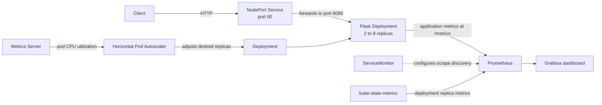
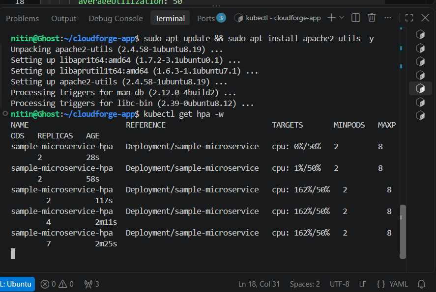
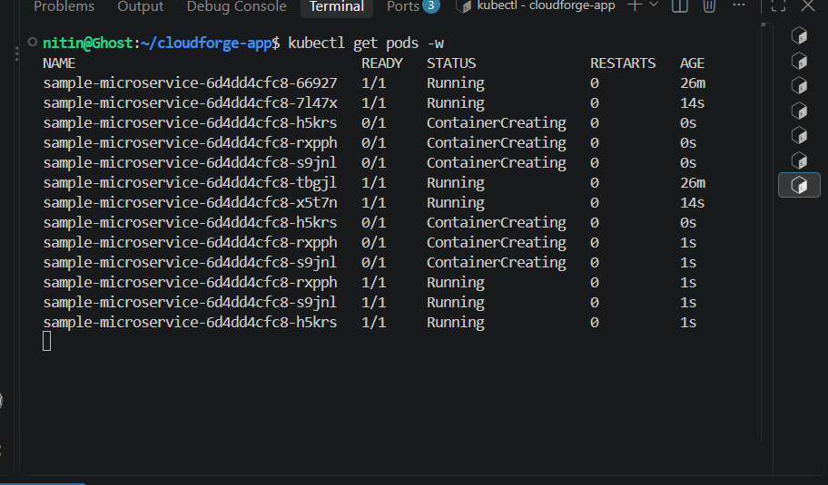
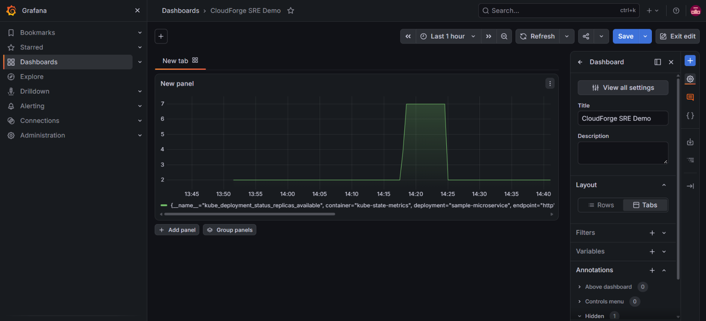

# Kubernetes SRE Observability Stack

A containerized Flask service deployed to Kubernetes with Prometheus metrics, health endpoints, and CPU-based horizontal autoscaling. The included screenshots document the workload scaling and monitoring behavior observed during a demo.

## Architecture



### Request and telemetry flow

1. Clients reach the Flask application through the Kubernetes NodePort Service. The Service forwards traffic to container port `8080`.
2. The `ServiceMonitor` selects the application Service and configures Prometheus to scrape the Flask Exporter metrics endpoint at `/metrics`.
3. Prometheus stores application and cluster metrics. Grafana queries Prometheus to visualize workload behavior, including available Deployment replicas.
4. The Horizontal Pod Autoscaler uses CPU utilization from the Kubernetes Metrics Server (not Prometheus) to scale the Deployment between 2 and 8 replicas. The configured CPU target is 50%.

## Components

| Component | Purpose |
| --- | --- |
| Flask | Serves the demo API, health endpoint, and Prometheus metrics. |
| Docker | Packages the application as `cloudforge-app:v1`. |
| Kubernetes Deployment and Service | Runs the application pods and exposes them through a NodePort Service. |
| Horizontal Pod Autoscaler | Scales replicas based on average CPU utilization. |
| Prometheus Operator ServiceMonitor | Configures Prometheus scraping for the application metrics endpoint. |
| Prometheus and Grafana | Collect and visualize application and Kubernetes metrics. |

## Demo screenshots

### CPU-driven autoscaling

The HPA output shows CPU utilization rising above the 50% target and the replica count increasing from 2 to 4 and then 7 (with a configured maximum of 8).



### Pod startup and readiness

During scale-up, new pods pass through `ContainerCreating` and become `Running` and ready.



### Grafana replica metrics

The Grafana panel shows available replicas rising from 2 to 7 and returning to 2 after the load subsides. The screenshot was captured while editing the dashboard.



## Project files

| Path | Description |
| --- | --- |
| `app.py` | Flask routes and Prometheus instrumentation. |
| `Dockerfile` | Container image definition. |
| `requirements.txt` | Python dependencies. |
| `deployment.yml` | Kubernetes Deployment and NodePort Service. |
| `hpa.yml` | CPU-based Horizontal Pod Autoscaler. |
| `servicemonitor.yml` | Prometheus Operator ServiceMonitor. |
| `docs/images/` | Demo screenshots embedded in this README. |

## Prerequisites

- Python 3.11 or later and pip (for running the app locally).
- Docker (for building the image).
- A Kubernetes cluster with the Metrics Server enabled (for HPA metrics).
- Prometheus Operator and Grafana (for ServiceMonitor-based scraping and dashboards).

The Prometheus Operator must be configured to discover this ServiceMonitor, including its `release: monitoring` label. The Grafana replica chart also requires Kubernetes state metrics to be available in Prometheus.

## Run locally

```bash
python -m pip install -r requirements.txt
python app.py
```

The application listens on port `8080`.

| Endpoint | Description |
| --- | --- |
| `GET /` | Returns service status. |
| `GET /health` | Returns the health status. |
| `GET /api/simulate-error` | Intentionally returns HTTP 500 about half the time to exercise error monitoring. |
| `GET /metrics` | Exposes Prometheus metrics. |

## Build and deploy

Build the image:

```bash
docker build -t cloudforge-app:v1 .
```

The Deployment uses `imagePullPolicy: Never`. Make the image available to your cluster before deploying (for example, load it into your local Kubernetes cluster).

Apply the Kubernetes manifests:

```bash
kubectl apply -f deployment.yml
kubectl apply -f hpa.yml
kubectl apply -f servicemonitor.yml
```

Check rollout and autoscaling:

```bash
kubectl get pods -w
kubectl get hpa -w
kubectl get svc sample-microservice
```

Use the assigned NodePort and a reachable Kubernetes node address to access the Service.
